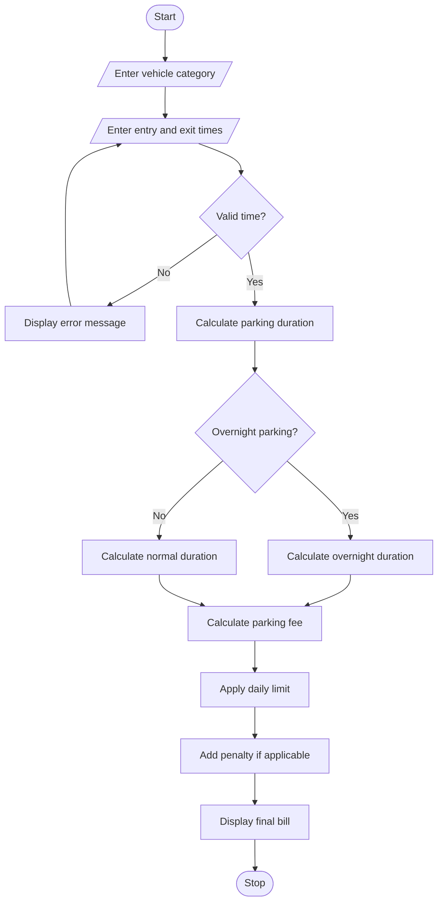

# 1. Problem Statement
Develop a Python program to calculate parking fees based on vehicle entry time, exit time, and vehicle category. The system should calculate parking duration, handle overnight parking, apply daily parking limits, and add penalties for invalid or special parking conditions. It should also validate time inputs and display the final parking bill.
# 2. Algorithm
1. Start the program.
2. Display the available vehicle categories.
3. Accept the vehicle category from the user.
4. Enter the vehicle entry time and exit time.
5. Validate the entered time format.
6. Check whether the vehicle stayed overnight.
7. Calculate the total parking duration.
8. Calculate the parking fee based on vehicle category.
9. Apply the daily maximum parking limit.
10. Add extra penalties if applicable.
11. Calculate the final parking amount.
12. Display the parking duration and total fee.
13. Stop the program.
# 3. Flowchart (Mermaid)

# 4. Python Source Code

from datetime import datetime, timedelta
import math

print("===== SMART PARKING FEE MANAGEMENT =====")

rates = {
    "bike": 15,
    "car": 30,
    "bus": 50
}

daily_limit = {
    "bike": 100,
    "car": 200,
    "bus": 400
}

vehicle = input("Enter vehicle type (Bike/Car/Bus): ").lower()

if vehicle not in rates:
    print("Invalid vehicle category!")
else:
    try:
        entry = input("Enter entry time (HH:MM): ")
        exit_time = input("Enter exit time (HH:MM): ")

        start = datetime.strptime(entry, "%H:%M")
        end = datetime.strptime(exit_time, "%H:%M")

        if end <= start:
            end += timedelta(days=1)

        duration = (end - start).total_seconds() / 3600

        hours = math.ceil(duration)
        days = math.ceil(duration / 24)

        normal_fee = hours * rates[vehicle]
        maximum_fee = days * daily_limit[vehicle]

        parking_fee = min(normal_fee, maximum_fee)

        overnight_fee = 0
        if end.date() > start.date():
            overnight_fee = 20

        lost_ticket = input("Lost ticket? (yes/no): ").lower()
        penalty = 100 if lost_ticket == "yes" else 0

        total = parking_fee + overnight_fee + penalty

        print("\n===== PARKING BILL =====")
        print("Vehicle Type:", vehicle.title())
        print("Parking Duration:", round(duration, 2), "hours")
        print("Charged Hours:", hours)
        print("Parking Fee: Rs.", parking_fee)
        print("Overnight Fee: Rs.", overnight_fee)
        print("Penalty: Rs.", penalty)
        print("-----------------------------")
        print("Total Amount: Rs.", total)

    except ValueError:
        print("Invalid time format! Enter time in HH:MM format.")
# 5. Sample Input
Enter vehicle type (Bike/Car/Bus): Car
Enter entry time (HH:MM): 22:30
Enter exit time (HH:MM): 01:15
Lost ticket? (yes/no): no
# 6. Sample Output
===== PARKING BILL =====
Vehicle Type: Car
Parking Duration: 2.75 hours
Charged Hours: 3
Parking Fee: Rs. 90
Overnight Fee: Rs. 20
Penalty: Rs. 0
-----------------------------
Total Amount: Rs. 110
# 7. Screenshot of Output

