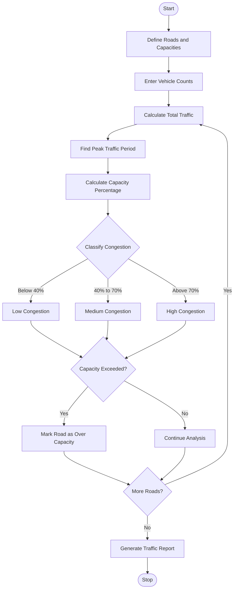

# 1. Problem Statement
The Traffic Flow and Congestion Analysis System is designed to process vehicle counts across multiple roads and time intervals. It calculates total traffic, identifies peak traffic periods, classifies congestion levels as Low, Medium, or High, and identifies roads that exceed their capacity limits. Finally, the system generates a traffic analysis report to help understand road congestion and traffic conditions.
# 2. Algorithm
1. Start the program.
2. Define multiple roads with their vehicle counts and capacity limits.
3. Record vehicle counts for different time intervals.
4. Calculate the total number of vehicles on each road.
5. Identify the time interval with the highest vehicle count.
6. Calculate the traffic percentage based on road capacity.
7. Classify congestion levels:
   - Low: Below 40%.
   - Medium: 40% to 70%.
   - High: Above 70%.
8. Check whether vehicle counts exceed road capacity.
9. Identify roads exceeding their capacity thresholds.
10. Display total traffic, peak
11.  periods, and congestion levels.
12. Generate the final traffic analysis report.
13. Stop the program.
# 3. Flowchart (Mermaid)

# 4. Source Code (Python)

# Traffic Flow and Congestion Analysis

roads = {
    "Main Road": {
        "capacity": 100,
        "counts": [60, 95, 120]
    },
    "Market Road": {
        "capacity": 80,
        "counts": [30, 55, 70]
    },
    "Highway": {
        "capacity": 150,
        "counts": [50, 80, 110]
    }
}

time_intervals = ["9:00 AM", "1:00 PM", "5:00 PM"]

print("TRAFFIC FLOW AND CONGESTION ANALYSIS")
print("------------------------------------")

overall_peak = 0
peak_road = ""
peak_time = ""

for road, data in roads.items():

    capacity = data["capacity"]
    counts = data["counts"]

    total = sum(counts)
    peak_count = max(counts)
    peak_index = counts.index(peak_count)

    percentage = (peak_count / capacity) * 100

    # Classify congestion
    if percentage < 40:
        level = "Low"
    elif percentage <= 70:
        level = "Medium"
    else:
        level = "High"

    # Check capacity threshold
    if any(count > capacity for count in counts):
        status = "Capacity Exceeded"
    else:
        status = "Within Capacity"

    # Find overall peak
    if peak_count > overall_peak:
        overall_peak = peak_count
        peak_road = road
        peak_time = time_intervals[peak_index]

    print("\nRoad:", road)
    print("Total Vehicles:", total)
    print("Peak Vehicles:", peak_count)
    print("Peak Time:", time_intervals[peak_index])
    print("Congestion Level:", level)
    print("Road Status:", status)

print("\nOVERALL TRAFFIC REPORT")
print("----------------------")
print("Peak Traffic Road:", peak_road)
print("Peak Traffic Time:", peak_time)
print("Maximum Vehicle Count:", overall_peak)

print("\nTraffic Analysis Completed.")
# 5. Sample Input
Road details
Road	Capacity	9:00 AM	1:00 PM	5:00 PM
Main Road	100	60	95	120
Market Road	80	30	55	70
Highway	150	50	80	110

Congestion classification
Traffic percentage	Congestion
Below 40%	Low
40%–70%	Medium
Above 70%	High
# 6. Sample Output
TRAFFIC FLOW AND CONGESTION ANALYSIS
------------------------------------

Road: Main Road
Total Vehicles: 275
Peak Vehicles: 120
Peak Time: 5:00 PM
Congestion Level: High
Road Status: Capacity Exceeded

Road: Market Road
Total Vehicles: 155
Peak Vehicles: 70
Peak Time: 5:00 PM
Congestion Level: High
Road Status: Within Capacity

Road: Highway
Total Vehicles: 240
Peak Vehicles: 110
Peak Time: 5:00 PM
Congestion Level: High
Road Status: Within Capacity

OVERALL TRAFFIC REPORT
----------------------
Peak Traffic Road: Main Road
Peak Traffic Time: 5:00 PM
Maximum Vehicle Count: 120

Traffic Analysis Completed.
# 7. PyCharm Screenshot

