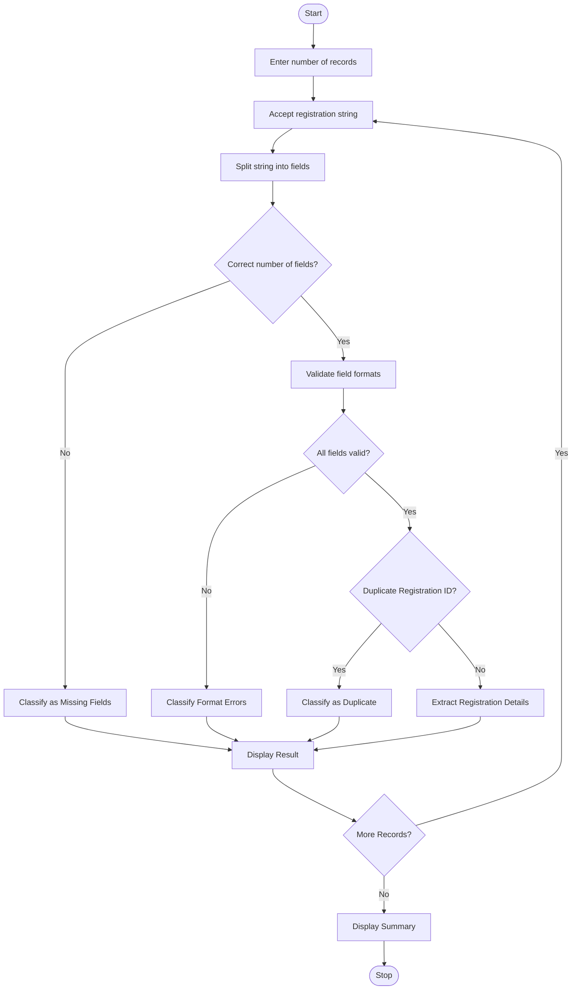

# 1. Problem Statement
Develop a Python program to analyze registration records stored as structured strings. The program should split each record into individual fields, validate field lengths and formats, extract required components, detect duplicate registration IDs, and classify errors. Finally, it should display valid records and error details in a structured format.
# 2. Algorithm
1. Start the program.
2. Define the registration record format.
3. Accept multiple registration records from the user.
4. Split each record using the delimiter |.
5. Check whether all required fields are present.
6. Validate registration ID, name, email, phone number, and course.
7. Check for duplicate registration IDs.
8. Classify errors as missing fields, invalid format, or duplicate record.
9. Extract valid registration components.
10. Display valid records and error classifications.
11. Stop the program.
# 3. Flowchart (Mermaid)

# 4. Source Code

import re

records = []
registered_ids = set()

def analyze_record(data):
    errors = []
    fields = data.strip().split("|")

    if len(fields) != 5:
        return ["Missing or extra fields"]

    reg_id, name, email, phone, course = fields

    # Validate registration ID
    if not re.fullmatch(r"REG\d{3}", reg_id):
        errors.append("Invalid Registration ID")

    # Validate name
    if not re.fullmatch(r"[A-Za-z ]{3,30}", name):
        errors.append("Invalid Name")

    # Validate email
    if not re.fullmatch(r"[\w.-]+@[\w.-]+\.\w{2,}", email):
        errors.append("Invalid Email")

    # Validate phone number
    if not re.fullmatch(r"\d{10}", phone):
        errors.append("Invalid Phone Number")

    # Validate course
    if not re.fullmatch(r"[A-Za-z ]{2,20}", course):
        errors.append("Invalid Course")

    # Check duplicate ID
    if reg_id in registered_ids:
        errors.append("Duplicate Registration ID")

    if not errors:
        registered_ids.add(reg_id)
        records.append({
            "ID": reg_id,
            "Name": name,
            "Email": email,
            "Phone": phone,
            "Course": course
        })
        return ["Valid Record"]

    return errors

print("REGISTRATION RECORD ANALYZER")
print("-" * 40)

n = int(input("Enter number of records: "))

for i in range(n):
    print("\nRecord", i + 1)
    data = input("Enter record (ID|Name|Email|Phone|Course): ")

    result = analyze_record(data)

    if result == ["Valid Record"]:
        print("Status: VALID")
        print("Extracted Details:", records[-1])
    else:
        print("Status: INVALID")
        print("Error Classification:", ", ".join(result))

print("\n========== FINAL SUMMARY ==========")
print("Total Records:", n)
print("Valid Records:", len(records))
print("Invalid Records:", n - len(records))

print("\nValid Registration Details:")
for record in records:
    print(record)
# 5. Sample Input
Enter number of records: 4

REG001|Arun Kumar|arun@gmail.com|9876543210|CSE
REG001|Ravi Kumar|ravi@gmail.com|9876543211|ECE
REG002|Sita Devi|sita@gmail|12345|CSE
REG003|John|john@gmail.com
# 6. Sample Output
REGISTRATION RECORD ANALYZER
----------------------------------------

Record 1
Status: VALID
Name: Arun Kumar
Registration ID: REG001

Record 2
Status: INVALID
Error: Duplicate Registration ID

Record 3
Status: INVALID
Error: Invalid Email, Invalid Phone Number

Record 4
Status: INVALID
Error: Missing or extra fields

========== FINAL SUMMARY ==========

Total Records: 4
Valid Records: 1
Invalid Records: 3
# 7. Screenshot

