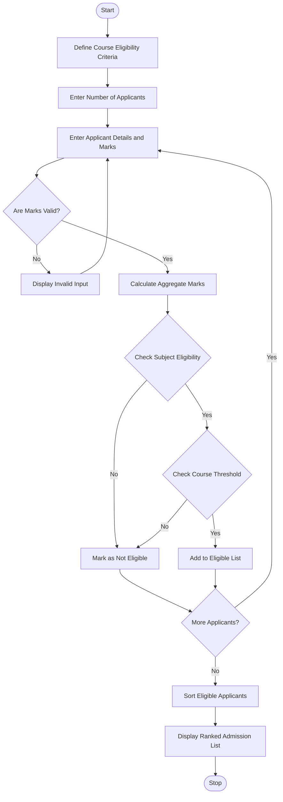

# 1. Problem Statement
The University Admission Decision Engine is designed to evaluate student applications based on subject eligibility, aggregate marks, and course-specific admission requirements. The system checks whether each candidate meets the minimum eligibility criteria for their selected course. Eligible candidates are ranked according to their aggregate marks and tie-breaking rules. Finally, the system generates a ranked list of eligible applicants for each course.
# 2. Algorithm
1. Start the program.
2. Define the minimum eligibility criteria for each course.
3. Accept the number of applicants.
4. Enter each applicant's name, application ID, course, and subject marks.
5. Validate the entered marks (0–100).
6. Calculate the aggregate percentage.
7. Check subject-wise eligibility.
8. Check the course-specific aggregate threshold.
9. Separate eligible and rejected applicants.
10. Sort eligible applicants using:
    - Highest aggregate marks.
    - Highest Mathematics marks in case of a tie.
    - Highest Physics marks if still tied.
    - Application ID in alphabetical order if still tied.
11. Display the ranked list of eligible applicants.
12. Display rejected applicants with their reasons.
13. Stop the program.
# 3. Flowchart (Mermaid)

# 4. Python Source Code

# University Admission Decision Engine

# Course eligibility criteria
courses = {
    "CSE": {"aggregate": 75, "math": 70, "physics": 65},
    "ECE": {"aggregate": 70, "math": 65, "physics": 60},
    "MECH": {"aggregate": 65, "math": 60, "physics": 55}
}

applicants = []

n = int(input("Enter number of applicants: "))

for i in range(n):
    print("\nEnter details of applicant", i + 1)

    app_id = input("Application ID: ")
    name = input("Student Name: ")
    course = input("Course (CSE/ECE/MECH): ").upper()

    while course not in courses:
        print("Invalid course! Try again.")
        course = input("Course (CSE/ECE/MECH): ").upper()

    marks = []
    subjects = ["English", "Mathematics", "Physics", "Chemistry"]

    for subject in subjects:
        while True:
            mark = int(input(subject + " Marks: "))
            if 0 <= mark <= 100:
                marks.append(mark)
                break
            print("Marks must be between 0 and 100.")

    aggregate = sum(marks) / len(marks)
    criteria = courses[course]

    if (aggregate >= criteria["aggregate"]
            and marks[1] >= criteria["math"]
            and marks[2] >= criteria["physics"]):

        applicants.append({
            "id": app_id,
            "name": name,
            "course": course,
            "aggregate": aggregate,
            "math": marks[1],
            "physics": marks[2]
        })

    else:
        print(name, "is NOT ELIGIBLE")

# Display ranked list course-wise
print("\n========== ADMISSION RESULTS ==========")

for course in courses:
    eligible = [a for a in applicants if a["course"] == course]

    eligible.sort(key=lambda a: (
        -a["aggregate"],
        -a["math"],
        -a["physics"],
        a["id"]
    ))

    print("\nCourse:", course)
    print("-" * 65)
    print("Rank  ID       Name        Aggregate")

    if not eligible:
        print("No eligible applicants.")
    else:
        for rank, student in enumerate(eligible, start=1):
            print(f"{rank:<6}{student['id']:<9}"
                  f"{student['name']:<12}"
                  f"{student['aggregate']:.2f}%")

print("\nAdmission evaluation completed.")
# 5. Sample Input
Enter number of applicants: 6

Applicant 1:
A101
Ananya
CSE
90 88 92 85

Applicant 2:
A102
Bharat
CSE
85 90 88 87

Applicant 3:
A103
Charan
ECE
78 72 68 80

Applicant 4:
A104
Divya
CSE
72 80 70 75

Applicant 5:
A105
Esha
MECH
68 62 58 70

Applicant 6:
A106
Farhan
CSE
88 90 88 90
# 6. Sample Output
Enter number of applicants: 6

Divya is NOT ELIGIBLE
Esha is NOT ELIGIBLE

========== ADMISSION RESULTS ==========

Course: CSE
-----------------------------------------------------------------
Rank  ID       Name        Aggregate
1     A106     Farhan      89.00%
2     A101     Ananya      88.75%
3     A102     Bharat      87.50%

Course: ECE
-----------------------------------------------------------------
Rank  ID       Name        Aggregate
1     A103     Charan      74.50%

Course: MECH
-----------------------------------------------------------------
Rank  ID       Name        Aggregate
No eligible applicants.

Admission evaluation completed.
# 7. Output Screenshot

