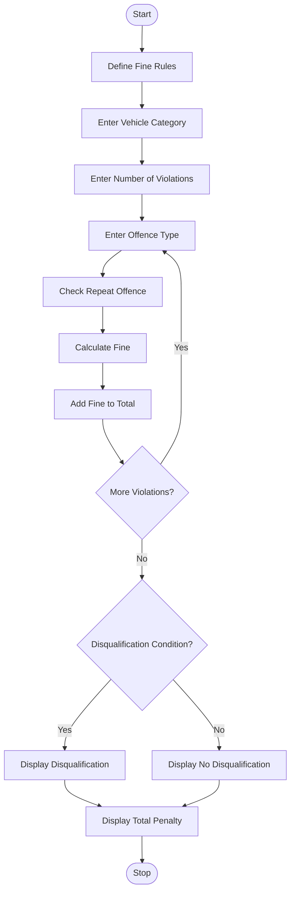

# 1. Problem Statement
The Traffic Violation Penalty Calculator is a Python program designed to calculate traffic fines for multiple violations. It considers vehicle categories, offence types, repeat offences, and predefined fine amounts. The program calculates the total penalty and identifies whether the driver is eligible for disqualification based on the number and severity of violations.
# 2. Algorithm
1. Start the program.
2. Define fine amounts for different offence types.
3. Enter the vehicle category.
4. Enter the number of traffic violations.
5. Accept the offence type for each violation.
6. Check whether the offence is repeated.
7. Calculate the fine based on the offence and vehicle category.
8. Add additional penalties for repeat offences.
9. Check disqualification conditions.
10. Display the total penalty and violation details.
11. Stop the program.
Note: The fine amounts and disqualification rules below are illustrative academic rules, not official traffic laws.
# 3. Flowchart (Mermaid)

# 4. Source Code (Python)
# Traffic Violation Penalty Calculator

fine_rules = {
    "speeding": 1000,
    "signal": 500,
    "helmet": 500,
    "drunk_driving": 5000
}

vehicle_rates = {
    "bike": 1.0,
    "car": 1.2,
    "heavy": 1.5
}

total_fine = 0
disqualified = False

print("TRAFFIC VIOLATION PENALTY CALCULATOR")

vehicle = input("Enter vehicle category (bike/car/heavy): ").lower()

if vehicle not in vehicle_rates:
    print("Invalid vehicle category!")
else:
    count = int(input("Enter number of violations: "))

    if count <= 0:
        print("Invalid number of violations!")
    else:
        for i in range(count):
            print("\nViolation", i + 1)

            offence = input(
                "Enter offence (speeding/signal/helmet/drunk_driving): "
            ).lower()

            if offence not in fine_rules:
                print("Invalid offence type!")
                continue

            repeat = input("Is it a repeat offence? (yes/no): ").lower()

            fine = fine_rules[offence] * vehicle_rates[vehicle]

            if repeat == "yes":
                fine *= 2

            total_fine += fine

            print("Fine for this offence: Rs.", fine)

            if offence == "drunk_driving":
                disqualified = True

        if count >= 3:
            disqualified = True

        print("\n---------- FINAL REPORT ----------")
        print("Vehicle Category:", vehicle)
        print("Total Violations:", count)
        print("Total Penalty: Rs.", total_fine)

        if disqualified:
            print("Driving Status: DISQUALIFICATION REQUIRED")
        else:
            print("Driving Status: NO DISQUALIFICATION")

        print("----------------------------------")
   # 5. Sample Input
        TRAFFIC VIOLATION PENALTY CALCULATOR

Enter vehicle category (bike/car/heavy): car
Enter number of violations: 3

Violation 1
Enter offence: speeding
Is it a repeat offence? (yes/no): no

Violation 2
Enter offence: helmet
Is it a repeat offence? (yes/no): yes

Violation 3
Enter offence: signal
Is it a repeat offence? (yes/no): no
# 6. Sample Output
TRAFFIC VIOLATION PENALTY CALCULATOR

Fine for this offence: Rs. 1200.0
Fine for this offence: Rs. 1200.0
Fine for this offence: Rs. 600.0

---------- FINAL REPORT ----------
Vehicle Category: car
Total Violations: 3
Total Penalty: Rs. 3000.0
Driving Status: DISQUALIFICATION REQUIRED
----------------------------------
# 7. Screenshot

