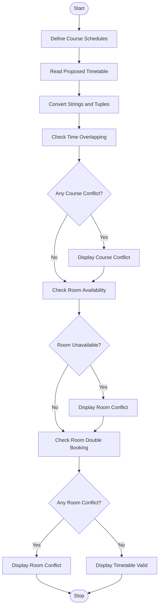

# 1. Problem Statement
The Student Timetable Conflict Detection System is designed to identify scheduling problems in a student's proposed timetable. It compares course schedules represented using strings and tuples, detects overlapping class periods, identifies unavailable rooms, and validates the proposed timetable. The system displays whether the timetable is valid or contains conflicts.
# 2. Algorithm
1. Start the program.
2. Define course schedules using strings and tuples.
3. Convert time values into minutes for easy comparison.
4. Read the proposed timetable and room availability details.
5. Compare course schedules to detect overlapping periods.
6. Check whether the assigned rooms are unavailable.
7. Check whether the same room is assigned to two classes at overlapping times.
8. Display all detected conflicts.
9. If no conflicts are found, display "Timetable is Valid".
10. Stop the program.
# 3. Flowchart (Mermaid)

# 4. Source Code (Python)

import re

# Convert time into minutes
def time_to_minutes(time):
    hours, minutes = map(int, time.split(":"))
    return hours * 60 + minutes

# Convert string schedule into tuple
def parse_schedule(schedule):
    pattern = (
        r"(\w+)\s+(\d{2}:\d{2})-(\d{2}:\d{2})"
        r"\s+(Room\s+\w+)\s+(.+)"
    )

    match = re.fullmatch(pattern, schedule)

    if not match:
        raise ValueError("Invalid schedule format")

    day, start, end, room, course = match.groups()

    return (
        day,
        time_to_minutes(start),
        time_to_minutes(end),
        room,
        course
    )

# Check overlapping periods
def is_overlapping(a, b):
    return (
        a[0] == b[0]
        and a[1] < b[2]
        and b[1] < a[2]
    )

# Proposed timetable using strings and tuples
schedules = [
    "Monday 09:00-10:00 Room A Python",
    (
        "Monday", 570, 630,
        "Room B", "Mathematics"
    ),
    "Monday 09:30-10:30 Room C English",
    (
        "Tuesday", 600, 660,
        "Room A", "Physics"
    )
]

# Unavailable room periods
unavailable_rooms = [
    ("Monday", 570, 630, "Room B"),
    ("Tuesday", 600, 660, "Room C")
]

# Convert all schedules into tuples
timetable = []

for item in schedules:
    if isinstance(item, str):
        timetable.append(parse_schedule(item))
    else:
        timetable.append(item)

conflicts = []

# Check student timetable overlaps
for i in range(len(timetable)):
    for j in range(i + 1, len(timetable)):
        if is_overlapping(timetable[i], timetable[j]):
            conflicts.append(
                f"Course Conflict: {timetable[i][4]} "
                f"and {timetable[j][4]}"
            )

# Check room availability
for course in timetable:
    for room in unavailable_rooms:
        if (
            course[0] == room[0]
            and course[3] == room[3]
            and course[1] < room[2]
            and room[1] < course[2]
        ):
            conflicts.append(
                f"Room Conflict: {course[3]} "
                f"is unavailable for {course[4]}"
            )

# Check room double booking
for i in range(len(timetable)):
    for j in range(i + 1, len(timetable)):
        a = timetable[i]
        b = timetable[j]

        if a[3] == b[3] and is_overlapping(a, b):
            conflicts.append(
                f"Room Double Booking: {a[3]} "
                f"for {a[4]} and {b[4]}"
            )

# Display result
print("STUDENT TIMETABLE CONFLICT DETECTION")
print("-----------------------------------")

if conflicts:
    print("Timetable is INVALID")
    print("\nDetected Conflicts:")

    for conflict in conflicts:
        print("-", conflict)
else:
    print("Timetable is VALID")
    print("No scheduling conflicts found.")
# 5. Sample Input
The following schedules are used as input:
Day	Time	Room	Course
Monday	09:00–10:00	Room A	Python
Monday	09:30–10:30	Room B	Mathematics
Monday	09:30–10:30	Room C	English
Tuesday	10:00–11:00	Room A	Physics

Unavailable rooms:
- Monday, 09:30–10:30 – Room B
- Tuesday, 10:00–11:00 – Room C
  # 6. Sample Output
  STUDENT TIMETABLE CONFLICT DETECTION
-----------------------------------
Timetable is INVALID

Detected Conflicts:
- Course Conflict: Python and Mathematics
- Course Conflict: Python and English
- Course Conflict: Mathematics and English
- Room Conflict: Room B is unavailable for Mathematics
# 7. Output Screenshot

