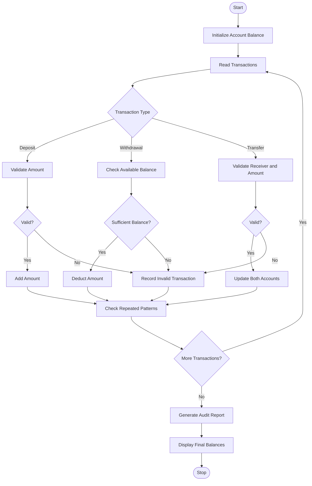

# 1. Problem Statement
The Multi-Stage ATM Transaction Audit System is designed to process multiple banking transactions in a simulated account. It supports deposits, withdrawals, and transfers while maintaining updated account balances. The system detects invalid transactions, such as insufficient balance, negative amounts, and unsupported operations. It also identifies suspicious repeated transaction patterns and generates a transaction audit report.
# 2. Algorithm
1. Start the program.
2. Initialize the account balance.
3. Define a sequence of transactions.
4. Read each transaction one by one.
5. Check the transaction type and amount.
6. If the transaction is a deposit, add the amount to the balance.
7. If it is a withdrawal, check the available balance and deduct the amount.
8. If it is a transfer, deduct the amount from the main account and add it to the receiver's account.
9. Detect invalid transactions and record the reasons.
10. Identify repeated transaction patterns.
11. Display the final account balances.
12. Generate the transaction audit report.
13. Stop the program.
# 3. Flowchart (Mermaid) 

# 4. Source Code (Python)

# Multi-Stage ATM Transaction Audit

accounts = {
    "MAIN": 1000,
    "SAVINGS": 0
}

transactions = [
    ("deposit", 1000),
    ("withdraw", 200),
    ("withdraw", 300),
    ("withdraw", 100),
    ("transfer", 250, "SAVINGS"),
    ("withdraw", 5000),
    ("deposit", -50),
    ("payment", 100)
]

invalid_transactions = []
audit_log = []
transaction_types = []
suspicious_patterns = []

for transaction in transactions:

    operation = transaction[0].lower()
    transaction_types.append(operation)

    try:
        amount = transaction[1]

        if not isinstance(amount, (int, float)) or isinstance(amount, bool):
            raise ValueError("Invalid amount")

        if amount <= 0:
            raise ValueError("Amount must be positive")

        if operation == "deposit":
            accounts["MAIN"] += amount
            audit_log.append(f"Deposit: Rs.{amount} - Successful")

        elif operation == "withdraw":
            if amount > accounts["MAIN"]:
                raise ValueError("Insufficient balance")

            accounts["MAIN"] -= amount
            audit_log.append(f"Withdrawal: Rs.{amount} - Successful")

        elif operation == "transfer":
            if len(transaction) != 3:
                raise ValueError("Receiver account missing")

            receiver = transaction[2]

            if receiver not in accounts or receiver == "MAIN":
                raise ValueError("Invalid receiver account")

            if amount > accounts["MAIN"]:
                raise ValueError("Insufficient balance")

            accounts["MAIN"] -= amount
            accounts[receiver] += amount

            audit_log.append(
                f"Transfer: Rs.{amount} to {receiver} - Successful"
            )

        else:
            raise ValueError("Unknown transaction type")

    except (ValueError, TypeError, IndexError) as error:
        message = f"Invalid {operation}: {error}"
        invalid_transactions.append(message)
        audit_log.append(message)

# Detect three or more consecutive transactions
# of the same type
count = 1

for i in range(1, len(transaction_types)):
    if transaction_types[i] == transaction_types[i - 1]:
        count += 1
    else:
        if count >= 3:
            pattern = (
                f"{transaction_types[i - 1]} repeated "
                f"{count} consecutive times"
            )
            suspicious_patterns.append(pattern)

        count = 1

if count >= 3:
    pattern = (
        f"{transaction_types[-1]} repeated "
        f"{count} consecutive times"
    )
    suspicious_patterns.append(pattern)

# Display audit report
print("MULTI-STAGE ATM TRANSACTION AUDIT")
print("---------------------------------")

print("\nTransaction Audit Log:")
for item in audit_log:
    print(item)

print("\nFinal Account Balances:")
for account, balance in accounts.items():
    print(f"{account}: Rs.{balance:.2f}")

print("\nInvalid Transactions:", len(invalid_transactions))

print("\nSuspicious Patterns:")
if suspicious_patterns:
    for pattern in suspicious_patterns:
        print("-", pattern)
else:
    print("No suspicious patterns detected.")

print("\nATM Audit Completed.")
# 5. Sample Input
MAIN ACCOUNT = Rs.1000
SAVINGS ACCOUNT = Rs.0
# 6. Sample Output
MULTI-STAGE ATM TRANSACTION AUDIT
---------------------------------

Transaction Audit Log:
Deposit: Rs.1000 - Successful
Withdrawal: Rs.200 - Successful
Withdrawal: Rs.300 - Successful
Withdrawal: Rs.100 - Successful
Transfer: Rs.250 to SAVINGS - Successful
Invalid withdraw: Insufficient balance
Invalid deposit: Amount must be positive
Invalid payment: Unknown transaction type

Final Account Balances:
MAIN: Rs.1150.00
SAVINGS: Rs.250.00

Invalid Transactions: 3

Suspicious Patterns:
- withdraw repeated 3 consecutive times

ATM Audit Completed.
# 7. Output Screenshot

