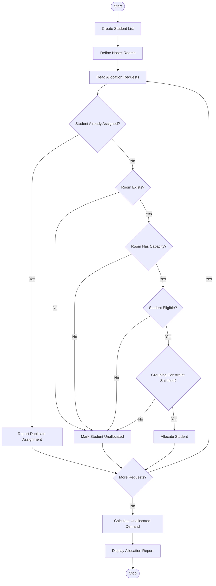

# 1. Problem Statement
The University Hostel Room Allocation System is designed to allocate students to hostel rooms based on room capacity, room eligibility, and grouping constraints. The system checks whether students meet the room requirements before assigning them. It also detects duplicate student assignments, prevents room overcapacity, and calculates the number of students who remain unallocated. Finally, it displays the room allocation details and generates an allocation report.
# 2. Algorithm
1. Start the program.
2. Create a list of students with their names and academic years.
3. Define hostel rooms with their capacity and eligibility.
4. Read the student allocation details.
5. Check whether the student is already assigned to a room.
6. Check room availability and remaining capacity.
7. Verify student eligibility for the selected room.
8. Check grouping constraints, such as allowing students from the same academic year in one room.
9. If all conditions are satisfied, allocate the student.
10. Otherwise, record the student as unallocated.
11. Calculate the remaining room capacity and unallocated student count.
12. Display the final allocation report.
13. Stop the program.
# 3. Flowchart (Mermaid)

# 4. Source Code (Python)

# University Hostel Room Allocation System

students = [
    ("S01", "Arun", 1, "standard"),
    ("S02", "Bala", 1, "standard"),
    ("S03", "Charan", 2, "standard"),
    ("S04", "Deepak", 1, "standard"),
    ("S05", "Eshan", 2, "standard"),
    ("S06", "Farhan", 2, "premium")
]

rooms = {
    "R101": {
        "capacity": 2,
        "allowed_years": [1, 2],
        "type": "standard",
        "students": []
    },
    "R102": {
        "capacity": 2,
        "allowed_years": [1],
        "type": "standard",
        "students": []
    },
    "R201": {
        "capacity": 1,
        "allowed_years": [2],
        "type": "premium",
        "students": []
    }
}

# Student ID and requested room
requests = [
    ("S01", "R101"),
    ("S02", "R101"),
    ("S03", "R101"),
    ("S04", "R102"),
    ("S05", "R102"),
    ("S06", "R201"),
    ("S01", "R102")
]

student_data = {s[0]: s for s in students}
assigned = set()
unallocated = set()
duplicates = []
allocation_log = []

for student_id, room_id in requests:

    # Check student existence
    if student_id not in student_data:
        allocation_log.append(
            f"Invalid student: {student_id}"
        )
        continue

    student = student_data[student_id]
    name, year, category = student[1], student[2], student[3]

    # Check duplicate assignment
    if student_id in assigned:
        duplicates.append(student_id)
        allocation_log.append(
            f"Duplicate assignment: {student_id}"
        )
        continue

    # Check room existence
    if room_id not in rooms:
        unallocated.add(student_id)
        allocation_log.append(
            f"{name}: Room {room_id} not found"
        )
        continue

    room = rooms[room_id]

    # Check room capacity
    if len(room["students"]) >= room["capacity"]:
        unallocated.add(student_id)
        allocation_log.append(
            f"{name}: {room_id} is full"
        )
        continue

    # Check academic year eligibility
    if year not in room["allowed_years"]:
        unallocated.add(student_id)
        allocation_log.append(
            f"{name}: Year eligibility failed for {room_id}"
        )
        continue

    # Check room type eligibility
    if category != room["type"]:
        unallocated.add(student_id)
        allocation_log.append(
            f"{name}: Room type not eligible for {room_id}"
        )
        continue

    # Grouping constraint: same academic year
    if room["students"]:
        existing_year = student_data[
            room["students"][0]
        ][2]

        if year != existing_year:
            unallocated.add(student_id)
            allocation_log.append(
                f"{name}: Grouping constraint failed in {room_id}"
            )
            continue

    # Allocate student
    room["students"].append(student_id)
    assigned.add(student_id)

    allocation_log.append(
        f"{name} allocated to {room_id}"
    )

# Calculate unallocated students
unallocated = set(student_data.keys()) - assigned

# Display report
print("UNIVERSITY HOSTEL ROOM ALLOCATION")
print("---------------------------------")

print("\nAllocation Details:")
for item in allocation_log:
    print(item)

print("\nRoom Occupancy:")
for room_id, room in rooms.items():
    print(
        room_id, ":",
        len(room["students"]),
        "/", room["capacity"]
    )

print("\nAllocated Students:", len(assigned))
print("Duplicate Assignments:", len(duplicates))
print("Unallocated Demand:", len(unallocated))

print("\nUnallocated Student IDs:")
if unallocated:
    for student_id in sorted(unallocated):
        print("-", student_id)
else:
    print("None")

print("\nHostel Allocation Completed.")
# 5. Sample Input
S01 -> R101
S02 -> R101
S03 -> R101
S04 -> R102
S05 -> R102
S06 -> R201
S01 -> R102
# 6. Sample Output
UNIVERSITY HOSTEL ROOM ALLOCATION
---------------------------------

Allocation Details:
Arun allocated to R101
Bala allocated to R101
Charan: Grouping constraint failed in R101
Deepak allocated to R102
Eshan: Year eligibility failed for R102
Farhan allocated to R201
Duplicate assignment: S01

Room Occupancy:
R101 : 2 / 2
R102 : 1 / 2
R201 : 1 / 1

Allocated Students: 4
Duplicate Assignments: 1
Unallocated Demand: 2

Unallocated Student IDs:
- S03
- S05
Hostel Allocation Completed.
# 7. Output Screenshot

   
