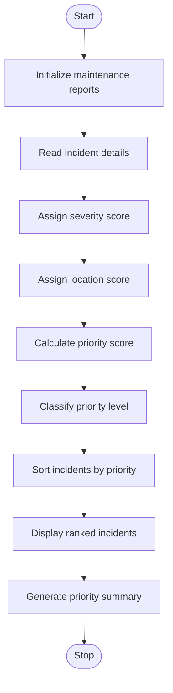

# 1. Problem Statement
The Smart Campus Incident and Maintenance Prioritization System is designed to manage and prioritize maintenance reports in a college campus. It classifies incidents based on severity, location, and reported frequency. The system assigns priority levels using predefined rules, ranks incidents from highest to lowest priority, and generates a summary to help maintenance staff solve important problems first.
# 2. Algorithm
1. Start the program.
2. Create a list of maintenance reports containing incident ID, description, severity, location, and frequency.
3. Read the maintenance reports.
4. Assign severity scores based on the reported severity.
5. Assign location scores based on the importance of the campus location.
6. Calculate the priority score using severity, location, and frequency.
7. Classify incidents as High, Medium, or Low priority.
8. Sort all incidents in descending order of priority score.
9. Display the ranked incident list.
10. Generate a priority summary.
11. Stop the program.
# 3. Flowchart (Mermaid)

# 4. Python Source Code

# Smart Campus Incident and Maintenance Prioritization

incidents = [
    ("I01", "Water Leakage", "High", "Hostel", 5),
    ("I02", "Broken Fan", "Low", "Classroom", 3),
    ("I03", "Electrical Issue", "High", "Laboratory", 4),
    ("I04", "Damaged Desk", "Medium", "Classroom", 2),
    ("I05", "Network Failure", "Medium", "Computer Lab", 5)
]

severity_score = {
    "High": 3,
    "Medium": 2,
    "Low": 1
}

location_score = {
    "Laboratory": 3,
    "Hostel": 3,
    "Computer Lab": 2,
    "Classroom": 1
}

results = []

for incident in incidents:
    incident_id, description, severity, location, frequency = incident

    score = (
        severity_score[severity] * 10
        + location_score[location] * 5
        + frequency * 2
    )

    if score >= 45:
        priority = "High"
    elif score >= 30:
        priority = "Medium"
    else:
        priority = "Low"

    results.append(
        (incident_id, description, score, priority)
    )

# Sort incidents by priority score
results.sort(key=lambda x: x[2], reverse=True)

print("SMART CAMPUS MAINTENANCE REPORT")
print("-" * 65)
print("ID   INCIDENT           SCORE   PRIORITY")
print("-" * 65)

for item in results:
    print(f"{item[0]:<5}{item[1]:<19}{item[2]:<8}{item[3]}")

# Generate summary
high = sum(1 for x in results if x[3] == "High")
medium = sum(1 for x in results if x[3] == "Medium")
low = sum(1 for x in results if x[3] == "Low")

print("-" * 65)
print("PRIORITY SUMMARY")
print("High Priority  :", high)
print("Medium Priority:", medium)
print("Low Priority   :", low)
print("Total Incidents:", len(results))
# 5. Sample Input
ID	Incident	Severity	Location	Frequency
I01	Water Leakage	High	Hostel	5
I02	Broken Fan	Low	Classroom	3
I03	Electrical Issue	High	Laboratory	4
I04	Damaged Desk	Medium	Classroom	2
I05	Network Failure	Medium	Computer Lab	5

Priority calculation:

Priority Score = (Severity × 10) + (Location × 5) + (Frequency × 2)
# 6. Sample Output
SMART CAMPUS MAINTENANCE REPORT
-----------------------------------------------------------------
ID   INCIDENT           SCORE   PRIORITY
-----------------------------------------------------------------
I01  Water Leakage      55      High
I03  Electrical Issue   53      High
I05  Network Failure    40      Medium
I04  Damaged Desk       29      Low
I02  Broken Fan         21      Low
-----------------------------------------------------------------
PRIORITY SUMMARY
High Priority  : 2
Medium Priority: 1
Low Priority   : 2
Total Incidents: 5
# 7. Screenshot

